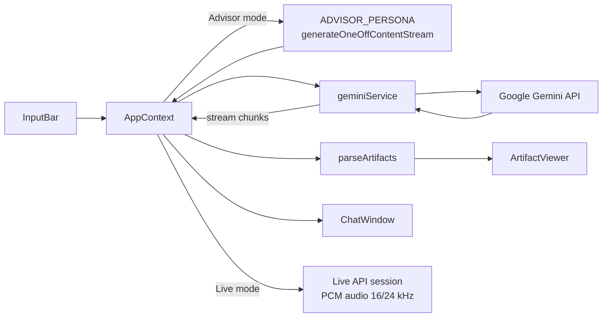

# 光 HIKARU-AI

**Remix: AIT Hikaru AI v3.6 [RMX]** — an advanced AI engineering and prompt-optimization assistant

## Overview

HIKARU-AI is a client-side Gemini chat application built around the **Hikaru persona** — a
structured, protocol-driven AI collaborator that analyzes requests through linguistic,
ethical, and strategic lenses before responding. It supports six operational modes,
real-time voice conversation, on-the-fly artifact rendering, and self-evaluation tooling,
all in a single React application.

## Operational Modes

| Mode | Persona | Model | Purpose |
|------|---------|-------|---------|
| Standard | `HIKARU_PERSONA` (v3.9 protocol) | `gemini-3-flash-preview` | Five-part structured analysis: linguistic, ethical, strategic, interjection, solution framework |
| Advisor | `ADVISOR_PERSONA` → Hikaru | same | Two-stage pipeline: detached internal advisor analyzes the request, then Hikaru formulates the final response |
| Efficiency | `HIKARU_EFFICIENCY_PERSONA` | `gemini-2.5-flash-lite-latest` | Direct, token-conserving answers without the full protocol |
| Security Review | `SECURITY_REVIEW_PERSONA` | standard model | Red-Team-style vulnerability reports with severity ratings and mitigations |
| Thinking | Hikaru | `gemini-3-pro-preview` (32,768 token thinking budget) | Deep reasoning; requires an explicitly selected API key via the AI Studio key gate |
| Live Voice | `HIKARU_LIVE_PERSONA` | `gemini-2.5-flash-native-audio-preview-09-2025` | Real-time bidirectional audio (16 kHz in / 24 kHz out, voice: Zephyr) with live transcription |

## Features

- **Immersive artifacts** — code and Markdown emitted via `<artifact>` tags are parsed live from the stream and rendered in a dedicated viewer panel
- **Hyperdimensional analysis** — Causal, Probabilistic, and Abstract overlay modes injected before the request
- **Scenario simulation** — structured-JSON best/worst/most-likely outcome forecasting per response
- **Meta-analysis debriefing** — request the reasoning and methodology behind any Hikaru response
- **Image generation** — keyword-triggered via `gemini-2.5-flash-image`
- **Feedback loop** — like/dislike scoring feeding a satisfaction metric and system-optimization modal
- **Status telemetry bar** — ethical status, interaction count, and intent-drift indicators (currently simulated)
- Prompt library, file attachments, streaming responses, animated particle UI

## Architecture

